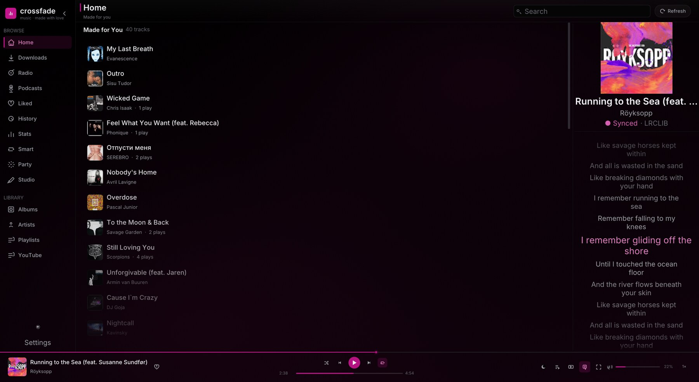
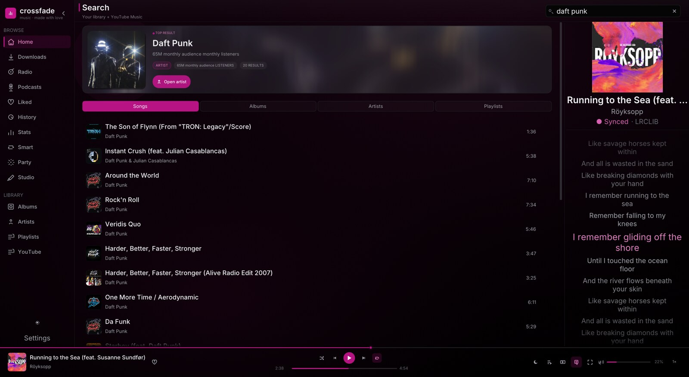
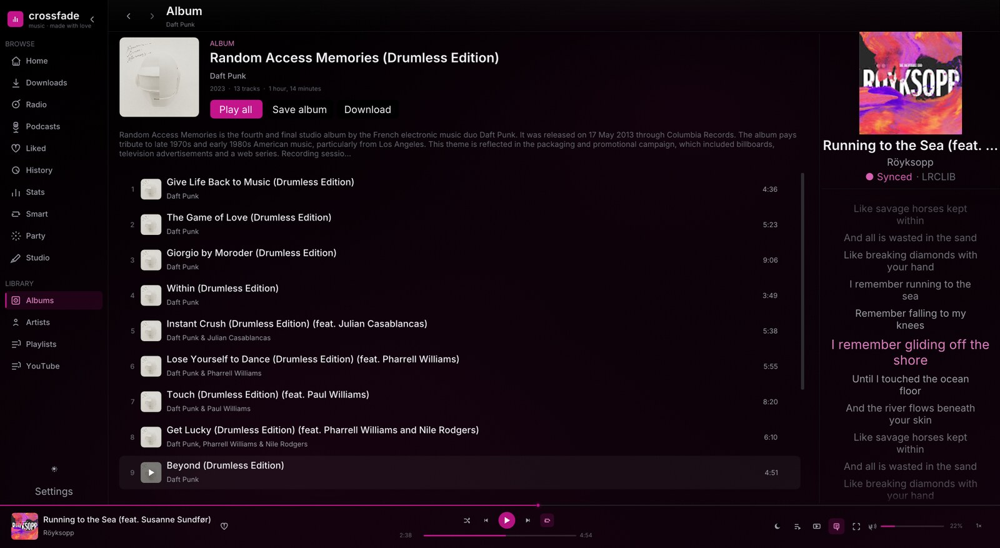
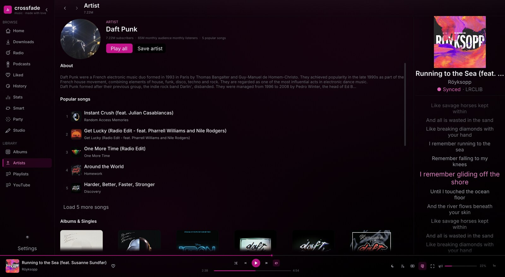
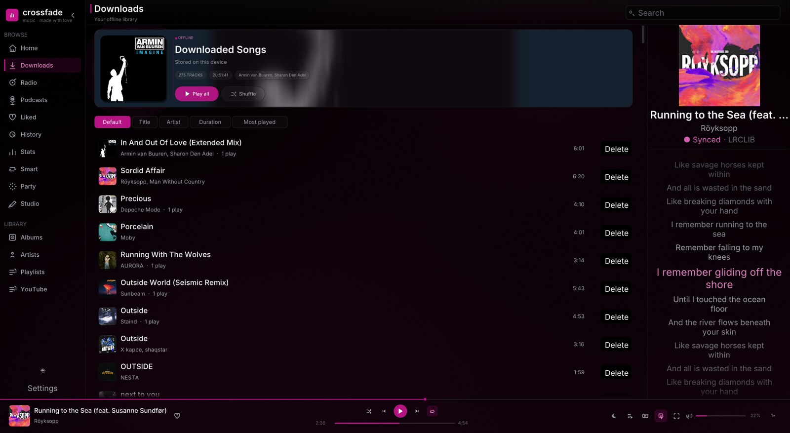
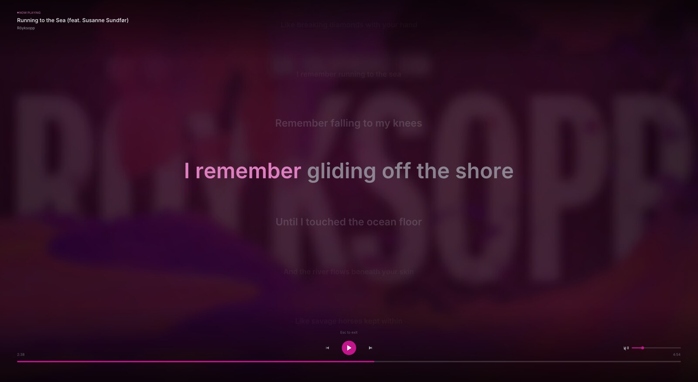
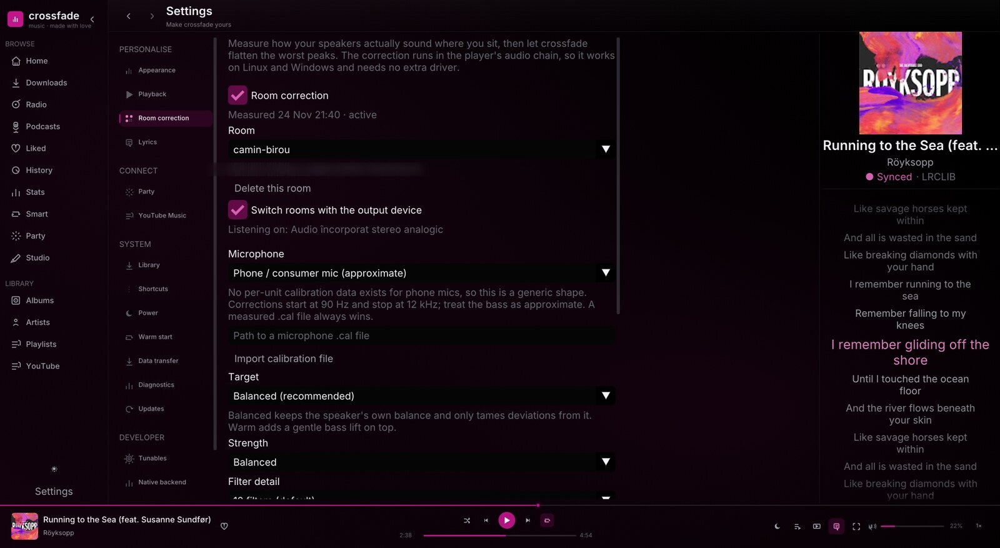
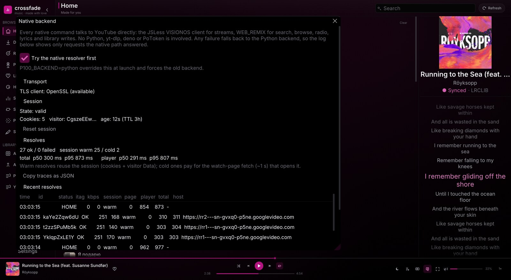
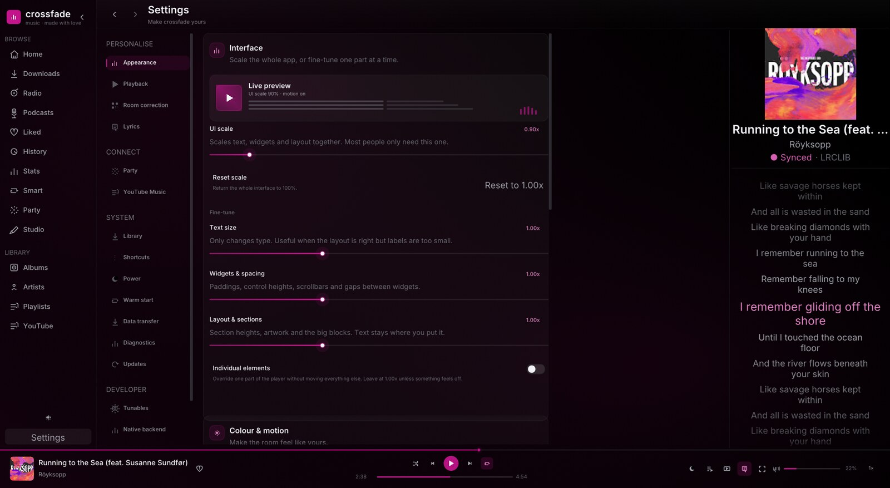

<div align="center">


# crossfade

### YouTube Music, without the browser tax.

**A native C++ YouTube Music client.** No Electron. No Chromium. No yt-dlp, deno, Python or PoToken on the hot path.

Uncached tracks resolve in **~120 ms** on a warm session. Playlists, albums, radio, search, lyrics, podcasts and your library are served by a native InnerTube client, with the Python backend kept as a safety net — not as the fast path.

[](../../releases)
[](LICENSE)
[](#platform-support)
[](../../actions)
[](https://isocpp.org/)

[**Download**](../../releases) · [Screenshots](#screenshots) · [Why crossfade](#why-crossfade) · [Performance](#performance) · [Install](#install-linux) · [How it works](#how-it-works)

</div>

<div align="center">
<a href="docs/screenshots/native-home.jpg"></a>
</div>

> **Two HTTPS requests. One C++ process. Your music starts before the web player has finished loading its first script.**
>
> crossfade talks to YouTube Music directly: a watch-page request opens a session, then the `VISIONOS` InnerTube client returns plain audio URLs — no signature challenge, no `deno`, no PoToken. Browse, search, radio, lyrics and library writes use the same session through `WEB_REMIX`. The Python backend is still shipped and still used when something fails; it is simply no longer what you wait for.

---

## Why crossfade

- **It is genuinely fast.** A warm stream resolve is **111–126 ms** in the native backend. An album opens in **~350 ms**, 50 radio tracks in **~490 ms**, a 182-track playlist in **~1 s**. The first uncached track after a launch pays one ~1 s watch-page request and then stays warm for three hours.
- **Native, not a browser in a trench coat.** One C++17 binary, SDL2 + OpenGL + Dear ImGui, libmpv for audio. Idle RAM is ~116 MB, not the 300–600 MB an Electron music client can occupy. No bundled Chromium, no Node runtime, no 500 MB of JavaScript.
- **Offline is the default, not a mode.** Everything you play is cached as it streams. Explicit downloads now use the native resolver too and remux with `ffmpeg` (no yt-dlp JS dance), so an album download survives even when YouTube puts the account into its SABR-only experiment. Verified with the network fully blocked: the cached track still starts.
- **Lyrics worth leaving on screen.** Word/syllable-timed lyrics from Unison/Better Lyrics (TTML and enhanced LRC), line-timed YouTube Music/LRCLIB/lyrics.ovh as fallback, automatic translations and romanization cached with every line, click-to-seek, and a full-screen immersive view with the album art as its stage. The current view renders line timing; the word-by-word presentation is the next pass. When a track has no lyrics, the takeover shows the cover and artist instead of an empty page.
- **Room correction that actually measures your room.** Sweep with your phone, get a per-room correction curve, bind rooms to output devices, and let crossfade apply it in the player's audio chain. No extra driver, no external EQ app.
- **Your library, actually yours.** Likes, saved albums and artists, playlists, local history, downloads and YouTube account playlists — mirrored locally, with write-back to YouTube Music.
- **And real crossfade.** Two libmpv players blend tracks into each other — 0–20 s on natural ends, a shorter fade on skips, instant switches for uncached targets.
- **Party mode, low power, stats, smart lists, M3U/XSPF, media keys, MPRIS/SMTC.** The features the web player forgot, in a window that idles at near-zero CPU.

**If crossfade saves you a browser tab, a ⭐ helps other people find it.**

## Performance

Measured on the author's Linux desktop (Fedora, 16 threads, performance profile) against the native backend. Timings are wall-clock from the in-app Native Backend page (F3) and the direct resolver harness; each row is a warm session unless noted. Your network and machine will differ — the method is part of the point.

| Operation | Native backend |
|---|---:|
| Stream resolve, warm | **111–126 ms** |
| Stream resolve, first after launch | **~1.2 s** (one watch-page request) |
| Album page (13 tracks) | **~350–500 ms** |
| Artist page (top songs + albums) | **~380–830 ms** |
| Playlist, 182 tracks (all pages) | **~1.0–1.4 s** |
| Radio station, 50 tracks | **~490 ms** |
| Home feed, 40 tracks | **~320–870 ms** |
| Search, 20 songs | **~400–800 ms** |
| Download, 2.7 MB opus | **~1 s** |

| App shell | crossfade |
|---|---:|
| Cold start → window painted | **~0.30 s** |
| Cold start → first audio (cached) | **~0.35 s** |
| Warm start (resident window) | **0 s** |
| Idle RAM | **~116 MB** |
| Playing RAM | **~128 MB** |
| Idle CPU | **~0%** |
| Binary + assets + backend package | **~7.9 MB** |

<details>
<summary>How these were measured</summary>

- **Native rows** are from the F3 Native Backend page (p50/p95 over the traces) and direct `native::resolve_audio` / browse harnesses run against the live service. Cold resolve includes the watch-page fetch; warm rows reuse the 3-hour session. Album/artist/playlist/radio/home rows include the InnerTube request and JSON parse, not artwork downloads.
- **Shell rows** come from `./scripts/bench.sh`: cold start to the `boot: first frame` / `boot: first audio` log lines, RSS from `VmRSS` after settling, CPU sampled over a 4 s window and divided by the 16 hardware threads.
- Low power mode (Settings → System → Power, `--low-power`, `P100_LOW_POWER=1`) caps the UI at ~4 FPS, disables motion and speculative warming, and skips background downloads. Playback is unchanged.
</details>

## Screenshots

<a href="docs/screenshots/native-search.jpg"></a>
<a href="docs/screenshots/native-album.jpg"></a>
<a href="docs/screenshots/native-artist.jpg"></a>
<a href="docs/screenshots/native-downloads.jpg"></a>
<a href="docs/screenshots/native-lyrics.jpg"></a>
<a href="docs/screenshots/native-room-eq.jpg"></a>
<a href="docs/screenshots/native-backend.jpg"></a>
<a href="docs/screenshots/native-settings.jpg"></a>

More: [search albums](docs/screenshots/native-search-albums.jpg).

## More screens

| Radio | Now playing / queue | Stats |
|:---:|:---:|:---:|
|  |  |  |

| Party mode | Smart lists | History |
|:---:|:---:|:---:|
|  |  |  |

| Saved albums | Playlists | Liked |
|:---:|:---:|:---:|
|  |  |  |

## Where crossfade fits

Most YouTube Music desktop apps are the website running inside Electron. crossfade is a
native C++ client: it draws its own interface and hands audio to libmpv.

| | Electron clients¹ | **crossfade** |
|---|:---:|:---:|
| Resolver | website in Chromium | **native C++ InnerTube** |
| Hot-path dependencies | Node + Chromium | **none** (Python/deno optional fallback) |
| Cold start → window | seconds | **~0.30 s** |
| Idle RAM | 300–600 MB | **~116 MB** |
| Real crossfade | ❌ | ✅ |
| Automatic offline cache | partial | ✅ |
| Measured room EQ | ❌ | ✅ |
| LAN party mode (phone queue) | ❌ | ✅ |
| Synced lyrics + click-to-seek | ✅ | ✅ |
| Media keys / MPRIS / SMTC | ✅ | ✅ |
| GPL-3.0 | mixed | ✅ |

¹ th-ch/youtube-music, ytmdesktop.

**Credit where it is due:** [ytm-rs](https://github.com/grapedjuice/ytm-rs) is the other
native YouTube Music client, and the reason this backend exists. Its work with the
`visionOS` player showed that plain stream URLs were possible without a browser, a JS
runtime or a signature puzzle. It is excellent — Rust/egui, karaoke-style lyrics, themes,
jams, downloads and crossfade. crossfade is a different stack with a different set of
extras: phone-measured room correction, a LAN party queue, a native browse/lyrics/podcast
layer and a Python fallback. Try both; use the one that fits you.

## Common questions

**Do I need an account?**
No. Guest mode gives you public search, albums, artists, radio, podcasts, lyrics, downloads and local playlists. Personalized Home, your YouTube playlists and write-back need a sign-in.

**Isn't signing in annoying?**
One-time, about 30 seconds: import your browser session with `crossfade-login`. The app refreshes the expiring request hash from the cookies at startup; when the cookies themselves expire (weeks to months), re-importing fixes it. OAuth remains available as an experimental alternative.

**How is this different from ytm-rs?**
ytm-rs is a great native client and the direct inspiration for this backend: it showed the
`visionOS` player could hand back plain URLs. It is Rust/egui, with karaoke-style
word-by-word lyrics, themes, jams, downloads and crossfade. crossfade is C++/ImGui and
focuses on phone-measured room correction, a LAN party queue, a native browse/lyrics/
podcast layer and a Python backend as a permanent fallback. Different stacks and different
extras — use the one that fits you.

**Is this allowed?**
It talks to YouTube Music with your own account, using the same public web endpoints the site uses. Not affiliated with or endorsed by Google. GPL-3.0. No telemetry, no server; requests go to YouTube and nowhere else.

**Why not Electron?**
Because a music player should not ship a browser. One native binary, libmpv, no Chromium.

**Linux or Windows?**
Both are first-class: AppImage/deb/rpm/AUR and source builds on Linux; an MSYS2 UCRT64 build with a one-click PowerShell installer on Windows. macOS is not started.

---

## Contents

- [Why crossfade](#why-crossfade)
- [Performance](#performance)
- [Screenshots](#screenshots)
- [Where crossfade fits](#where-crossfade-fits)
- [Install (Linux)](#install-linux)
- [Install on Windows](#install-on-windows-one-click)
- [Sign in](#sign-in)
- [A quick tour](#a-quick-tour)
- [Everyday use](#everyday-use)
- [Party mode](#party-mode)
- [Controls](#controls)
- [Configuration](#configuration)
- [How it works](#how-it-works)
- [Development](#development)
- [Platform support](#platform-support)
- [Troubleshooting](#troubleshooting)
- [Known limitations](#known-limitations)
- [Contributing](#contributing)
- [License](#license)
- [Acknowledgments](#acknowledgments)


## Install (Linux)

### Prebuilt packages (recommended)

Grab the latest file for your distro from [Releases](../../releases):

| File | For |
|---|---|
| `crossfade-*-x86_64.AppImage` | **Anything** — one file, run it. No install. |
| `crossfade-*-amd64.deb` | Debian, Ubuntu, Mint, Pop!_OS (`sudo apt install ./crossfade-*amd64.deb`) |
| `crossfade-*-x86_64.rpm` | Fedora / openSUSE (`sudo dnf install ./crossfade-*x86_64.rpm`) — `mpv-libs` comes from RPM Fusion |
| `crossfade-*-linux-x64.tar.gz` | Manual installs to any prefix |

Arch users: `packaging/arch/PKGBUILD` in this repo builds via `makepkg -si`.

Gentoo users: copy `packaging/gentoo/media-sound/crossfade` into a local
overlay (or submit it to GURU). The ebuild builds with CMake and uses the
system `ytmusicapi`/`yt-dlp` packages instead of a private venv.

The packages set up the Python backend for you during install (one-time
network fetch of `ytmusicapi` + `yt-dlp`). The AppImage bootstraps it into
`~/.local/share/crossfade/venv` on first launch.

### Build from source

crossfade installs per-user (no root) and manages its own Python environment.

### 1. Native dependencies

A handful of library headers, available in every mainstream distro:

```bash
# Debian / Ubuntu / Mint
sudo apt install build-essential cmake pkg-config libsdl2-dev libgl1-mesa-dev \
                 libmpv-dev libglib2.0-dev libnotify-dev libssl-dev ffmpeg \
                 python3 python3-venv curl

# Arch / Manjaro
sudo pacman -S --needed base-devel cmake sdl2 mesa mpv glib2 libnotify openssl ffmpeg python curl

# Fedora
sudo dnf install @development-tools cmake SDL2-devel mesa-libGL-devel \
                 mpv-devel glib2-devel libnotify-devel openssl-devel ffmpeg \
                 python3 python3-pip curl
```

`./install.sh` also provisions the JavaScript runtime yt-dlp needs for
YouTube's signature challenges: a pinned, checksummed Deno release
(~40 MB download) under `<prefix>/share/crossfade/runtime/deno`. This is not a
build dependency — the app just passes its path to yt-dlp. A system `deno` or
`node` is used when present, `P100_SKIP_JS_RUNTIME=1` skips the download, and
offline installs can pre-place the release zip as
`share/crossfade/runtime/deno.zip`.

You need **mpv ≥ 0.35** (libmpv is what the app links against).

Public party links (the Party tab default) additionally need **`cloudflared`**;
same-Wi-Fi parties work without it. Install it from your package manager where
available, or from
[Cloudflare's downloads page](https://developers.cloudflare.com/cloudflare-one/connections/connect-networks/downloads/).
If it is missing, crossfade says so in **Settings → Party** and when you try to
start a party.

### 2. Build and install

```bash
git clone <this-repo> crossfade
cd crossfade
./install.sh
```

`install.sh`:

- configures and builds a **Release** binary into `build/`;
- installs `~/.local/bin/crossfade` and `~/.local/bin/crossfade-login`;
- installs the backend, requirements, and fonts under `~/.local/share/crossfade/`;
- creates an isolated venv at `~/.local/share/crossfade/venv` with `ytmusicapi` + `yt-dlp`;
- installs a desktop entry (`~/.local/share/applications/crossfade.desktop`) with an
  absolute `Exec=` path, plus the app icon.

Nothing else needs to be installed by hand.

> If `~/.local/bin` is not on your `PATH`, either add it to your shell profile or call the
> binaries by full path (`~/.local/bin/crossfade`, `~/.local/bin/crossfade-login`).

### 3. Sign in

One time — see [Sign in](#sign-in).

### 4. Run

Launch **crossfade** from your application menu, or run `crossfade` in a terminal.

#### Warm start (instant relaunch)

Keep one background instance resident and make later launches instant:

```bash
crossfade --warm &   # from ~/.xinitrc or your desktop autostart
crossfade            # 0 s of startup: shows/raises the resident window
crossfade --toggle   # hide/show
crossfade --quit     # stop the background instance
```

Choose what stays resident in **Settings → System → Warm start**:
*Everything* keeps the UI and all three Python backends warm (~150–260 MB PSS);
*Main backend only* and *UI only* park the optional backends to save RAM.
Closing the window hides it while warm start is on. `--new-instance` bypasses
the single-instance socket and starts a second copy.

On Windows the same commands use a per-session named pipe. The installer asks
whether crossfade should start hidden when you sign in; the Start Menu shortcut
then raises the resident instance with no startup cost.

<details>
<summary><b>Other ways to build and run</b></summary>

```bash
# Custom install prefix
PREFIX=/opt/crossfade ./install.sh

# Reinstall data only (skip compiling)
SKIP_BUILD=1 ./install.sh

# Offline install: pre-download wheels into ./wheels first
mkdir wheels && pip download -d wheels -r requirements.txt
./install.sh

# Development loop: build into build/ and run from there (no install)
./mk

# Manual build
cmake -S . -B build -DCMAKE_BUILD_TYPE=Release
cmake --build build -j"$(nproc)"
./build/crossfade
```

The installer honours `PREFIX`, `BUILD_DIR`, and `SKIP_BUILD`; the app itself honours
`P100_CONFIG_DIR` (see [Configuration](#configuration)). `./dist.sh` produces a portable
source tarball; `./scripts/crossfade-export.sh` and `./scripts/crossfade-import.sh` move
your data between machines.

</details>

## Install on Windows (one click)

No admin rights, no build tools:

1. Grab **`install-crossfade.cmd`** from the [latest release](https://github.com/XBoom31/crossfade/releases/latest)
   and double-click it.
2. Launch **crossfade** from the Start Menu. The installer also asks whether it
   should start hidden when you sign in (warm start).
3. Sign in once: **Settings → YouTube Music → Sign in** inside the app. It uses
   the Windows WebView2 engine when the optional `pywebview` package is
   installed (the installer tries), and otherwise offers the paste panel. Start
   Menu → **crossfade-login** still works too. See [Sign in](#sign-in).

The installer sets up everything per-user under `%LOCALAPPDATA%\crossfade`:
the app with every runtime DLL bundled (SDL2, libmpv + codecs, and Mesa
llvmpipe software OpenGL, so it starts even without a GL 3.2 driver — remove
`opengl32.dll`, `libgallium_wgl.dll` and `dxil.dll` from `bin\` to use your
GPU driver instead), a private Python 3.12, the backend venv with
`ytmusicapi` + `yt-dlp`, and Start Menu shortcuts.

### Updates

crossfade checks the latest GitHub release at startup (at most once a day) and
offers a toast when something newer exists. **Settings -> Updates** shows the
installed and latest versions, the last check, and lets you check manually or
turn the automatic check off. The check only fetches the release's tiny
`version.txt`; there is no telemetry.

- **Windows:** **Update now** launches the one-click installer, which downloads
  the new build, replaces the installed files, and offers to restart crossfade.
- **Linux AppImage, release tarball and `install.sh` installs:** **Update now**
  downloads the matching release asset, verifies it against the release's
  `SHA256SUMS`, and stages it. A **Restart & update** toast then applies it
  during a clean shutdown and relaunches crossfade; if you ignore it, the
  update is applied on the next normal launch. Only crossfade's own files are
  replaced — settings, library, downloads, and the Python venv are preserved
  (install.sh and tarball updates refresh the venv when `requirements.txt`
  changes; the AppImage launcher owns its own venv).
- **Package-managed installs** (deb, rpm, Arch, Gentoo, or anything under
  `/usr`/`/usr/local`) are never modified in place. The action opens the
  release page so your package manager stays in charge.
- **Safe mode** pauses automatic checks and startup applies for that launch.
  Manual checks still work, and a staged update is kept for later.

Builds run directly from a source/build tree are not self-updatable; rebuild
and re-run `./install.sh` (or use the release page).

## Build on Windows

The same source tree builds on Windows with the MSYS2 UCRT64 toolchain (MinGW-w64) and
runs the same unit test suite. The Linux desktop integration (MPRIS, libnotify, GLib) is
swapped for native Windows equivalents — System Media Transport Controls and WinRT
toasts — rather than dropped.

```bash
# In a UCRT64 MSYS2 shell (C:\msys64\ucrt64.exe)
pacman -S --needed mingw-w64-ucrt-x86_64-toolchain mingw-w64-ucrt-x86_64-cmake \
                   mingw-w64-ucrt-x86_64-pkgconf mingw-w64-ucrt-x86_64-SDL2 \
                   mingw-w64-ucrt-x86_64-mpv
git clone <this-repo> crossfade
cd crossfade
cmake -S . -B build -DCMAKE_BUILD_TYPE=Release
cmake --build build
```

To run the exe outside the MSYS2 shell, copy `SDL2.dll`, `libmpv-2.dll`,
`libstdc++-6.dll`, `libgcc_s_seh-1.dll` and `libwinpthread-1.dll` from
`/ucrt64/bin` next to `crossfade.exe`. The Python backend needs a Windows Python 3
with `ytmusicapi` + `yt-dlp`; without it the UI runs but cannot reach YouTube Music.
A development venv next to the executable or in the repo works:

```powershell
python -m venv venv
venv\Scripts\python.exe -m pip install -r requirements.txt
```

`requirements.txt` installs `yt-dlp[default]`, which includes the EJS challenge
solver. Current yt-dlp also needs a JavaScript runtime; put `deno.exe` next to
`venv\Scripts\yt-dlp.exe` (the Windows installer does this automatically).

The Windows release installer creates that venv under `%LOCALAPPDATA%`.

## Sign in

crossfade talks to YouTube Music through `ytmusicapi`. It runs **without an account**
in guest mode — search, albums, artists, radio, lyrics, podcasts, downloads and local
playlists all work. Signing in is optional, and unlocks personalized recommendations
plus your YouTube Music playlists and library.

### Sign in from the app (recommended)

**Settings → YouTube Music → Sign in** opens a sign-in window using whatever
webview engine your system has, with no extra runtime bundled:

1. **WebKitGTK** 6.0 (GTK4), 4.1 or 4.0 (GTK3) — the usual Linux path.
2. **Qt WebEngine** if PyQt6/PySide6/PyQt5/PySide2 are installed.
3. **Windows WebView2** through the optional `pywebview` package. The installer
   adds it best-effort; the WebView2 runtime itself ships with Windows.

Most distributions do not install WebKitGTK by default (Fedora in particular),
so when no engine is found **Sign in imports an already signed-in browser
session**. If there is none, it opens YouTube Music in your browser; log in
there and press **Import session from this browser**. Imports are verified before
anything is replaced, need no extra packages, and are the normal path on stock
Fedora. The panel's **Sign-in methods detected** section shows what was found,
and what is missing when nothing is available. If an embedded window is
available but Google refuses it, the paste panel below always works.

### Paste request headers (works with any browser)

1. Open [music.youtube.com](https://music.youtube.com) in your browser and log in.
2. Open DevTools (**F12**) → **Network** tab.
3. Make a POST request happen: refresh the page or click any song.
4. Find a request to `music.youtube.com` (for example `youtubei/v1/browse`), right-click →
   **Copy → Copy request headers**.
5. In **Settings → YouTube Music → Paste request headers**, paste the whole
   block and click **Connect**. (Terminal users can still run
   `crossfade-login` and paste there.)

The helper cleans HTTP/2 pseudo-headers, cURL `-H`/`-b` output, wrapped Cookie
lines and Edge's multiple Cookie lines. It verifies the session against your
library *before* replacing `browser.json`, so a bad paste leaves the current
session untouched. A running crossfade picks up the new session automatically.

### Import an existing browser session

**Import session from this browser** reads the browser selected under
**Cookie browser** (Firefox, LibreWolf, Chrome, Chromium, Edge, Brave). Chrome
and Edge decryption is delegated to yt-dlp (DPAPI/libsecret/Keychain). This is
a one-click snapshot and is never used automatically: if the session has
expired, verification fails and nothing changes, so a fresh window sign-in is
still the reliable path.

Import reads only the `youtube.com` copy of the account cookies (Google stores
different `HSID`/`SSID`/`SIDCC`/`__Secure-*PSIDTS` values per domain, and a
mixed set is rejected as anonymous), tries every Firefox profile, and verifies
each one against the account with the same `logged_in` check the backend uses.
A signed-out browser now reports "signed out" instead of a misleading success,
and the Settings card and sidebar show **Guest mode** until the backend really
has a session. The backend refreshes the expiring `SAPISIDHASH` from the imported
cookies at startup, so a verified import keeps working instead of looking signed
out a day later.

Launch crossfade and everything — home feed, likes, playlists, lyrics — is yours.

> **Cookies expire** (weeks to months, Google's choice). When the home feed or search
> suddenly comes back empty, sign in again. It takes about 30 seconds.

> **Privacy tip:** copied headers contain your full Google session cookies. Consider a
> dedicated browser profile for the copy so your daily profile's cookies never leave it:
>
> ```bash
> firefox -P "crossfade" -no-remote                       # create once, log in there
> chromium --user-data-dir=~/.config/crossfade-browser    # Chromium-family equivalent
> ```

### Alternative: OAuth (experimental, CLI only)

An OAuth token is long-lived and refreshes automatically instead of expiring.
It is currently hidden in the interface because it requires your own Google
Cloud client and is not a one-click flow.

1. Create an OAuth client in the [Google Cloud Console](https://console.cloud.google.com/)
   → **APIs & Services → Credentials**, type **“TVs and Limited Input devices”**.
2. Set `P100_OAUTH_CLIENT_ID` and `P100_OAUTH_CLIENT_SECRET` **in the
   environment crossfade runs in**. No credentials are bundled.
3. Set `auth_mode` to `"oauth"` in `settings.json` and restart crossfade.
4. Run the login command below; it prints a device-code URL and waits for you
   to approve it (you can approve on another device):

```bash
~/.local/share/crossfade/venv/bin/python \
    ~/.local/share/crossfade/p100-backend-oauth.py --login
```

> The two backends share the same line-based JSON protocol. If you change one, change the
> other too — see [Development](#development).

## A quick tour

The window has four persistent regions:

| Region | What lives there |
|---|---|
| **Sidebar** | **Browse:** Home, Downloads, Radio, Podcasts, Liked, History, Stats, Smart, Party. **Library:** Albums, Artists, Playlists, YouTube. Settings is pinned at the bottom. |
| **Top bar** | Back / forward, the current view title and subtitle, search, and Refresh where it applies. |
| **Main area** | Track lists, album/artist detail pages, grids, the queue, stats, or the settings panel. |
| **Bottom bar** | Cover art, track + artist, like, previous / play-pause / next, sleep timer, Up Next, lyrics, volume, and the speed preset. |

### Views at a glance

- **Home** — recently searched chips and a “Made for You” list that mirrors the YouTube
  Music home feed (Quick picks, Mixed for you, and similar sections).
- **Downloads** — every cached track, with sort by title/artist/duration/most played and
  a per-track **Delete** action.
- **Radio** — an endless station seeded from your most-played tracks, plus **Start from**
  shortcuts and a station track list.
- **Liked** — liked songs with the same sorting and shuffle controls.
- **History** — a newest-first timeline with play counts, **Play all**, **Shuffle**, and
  **Clear history**.
- **Stats** — total plays, unique songs/artists, top artist, peak hour/day, streak, repeat
  rate, top-artist bars, and listening-by-hour charts for **All Time / This Month / This
  Week**.
- **Smart** — **On Repeat** (your most-played tracks) and **Recently Played**.
- **Party** — start a party with a public Cloudflare link (or same-Wi-Fi only),
  show the QR code, approve guest requests, and reopen the fullscreen code
  with `P`.
- **Albums / Artists** — saved grids; open any card for a detail page with **Play all**,
  save/unsave, and (for albums) download/delete.
- **Playlists** — local playlists on the left, tracks on the right, with create, rename,
  add/remove, M3U/XSPF export, and optional YouTube Music sync.
- **YouTube** — your YouTube Music account playlists, including the auto-generated
  “Liked Music”.
- **Up Next** — the playback queue, with a **Nothing queued** empty state and instructions
  for adding tracks.
- **Podcasts** — saved shows, catalogue search, episode playback, local show saving and offline downloads, served by the native `WEB_REMIX` browse client.
- **Settings** — a two-pane, card-based appearance, playback, lyrics, YouTube Music, cache, shortcuts, and a
  danger zone.

## Everyday use

### Search

Click the search box (or press `/` / `Ctrl+F`). Typing debounces briefly, then queries
YouTube Music; **Enter** searches immediately. Results have **Songs / Albums / Artists /
Playlists** tabs. While a search is open, the local list filters as you type. Clear the
query or press **Esc** to go back.

On the Home tab, the **Library** button next to the search box switches the same field to
your local library. It searches titles, artists, albums, and playlists stored in
`library.db` with FTS5, without contacting YouTube. The scope button is remembered for the
session; press **Library** again to return to YouTube search.

### Playing and queueing

- **Double-click** a row to play it (single tap on touchscreens).
- **Right-click** any track for **Like, Play next, Add to queue, Start Radio, View album,
  View artist, Add to playlist**.
- **Up Next is one global queue.** Starting a playlist, album, artist or radio list
  replaces it with that list (the clicked track plays now, the rest follows);
  **Play next** inserts at the front and **Add to queue** appends.
- **Next/Previous** always follow that queue, so pressing Next never skips past
  guest requests or other queued songs.
- **Shuffle** is available on the list views; **Play all** starts the list and
  queues the rest.
- **Endless music** (Settings) keeps a radio going when the list and queue run out.

### Music videos

- Press **V** (or the video button in the bottom bar) to show the current track's video
  in the main area. The top bar, sidebar and bottom bar stay exactly where they are;
  **Esc**, **V** or the close button returns to the list.
- The video replaces the list, not the whole body: with the lyrics panel open, the panel
  stays docked beside the picture, so you can watch the video and follow the lyrics at
  the same time. Only theater mode (**F**) takes the full width.
- Starting a search drops the video page back to the list (audio keeps playing), but you
  can press **V** again on any search result to watch that song's video while the search
  stays up.
- Audio keeps playing on its own player: opening, closing, seeking, or the video
  buffering never interrupts the sound. The page only appears once a real frame is
  decoded and the picture is running.
- The track's own upload appears immediately; if an official music video is found, it
  is swapped into the same page at the current position. Tracks that are already videos
  are used as-is instead of being matched to something else.
- Matching is a YouTube video search scored on title, artist and duration, cached in
  `video_map.json` (30 days). Matched videos are aligned automatically: a one-time
  cross-correlation of the song and video audio estimates the constant offset, accepted
  only when three independent windows agree, and cached in `video_sync.json`.
- While the video page is open, the next track's match is prefetched, and resolved
  stream URLs are cached on disk for an hour, so reopening is effectively instant.
- **F** or double-clicking the picture toggles theater mode; **Esc** leaves it first.
- **Settings → Playback → Music video quality** caps the stream at 720p, 1080p or the
  window height.
- **Right-click → Download video** stores an offline copy in `video_cache/`; it appears
  in **Downloads** (with a video badge) and plays without a network. **Remove downloaded
  video** deletes it. Video downloads are included in the data-transfer ZIP when the
  matching section is selected.
- The one-time alignment analysis is skipped in low power mode (cached offsets are still
  applied).

### Downloads and the cache

- Tracks are cached **as they stream**, so the second play is instant — with the network
  completely blocked, the cached track still starts.
- An album page has **Download** / **Download (n/m)** / **Delete download**.
- Downloads use the native resolver and remux with `ffmpeg -c:a copy` (~1 s for a 2.7 MB
  opus file), so they keep working when yt-dlp's web clients hit YouTube's SABR experiment.
  yt-dlp remains the fallback if the native path cannot resolve.
- **Settings → Download Cache** shows disk usage, a 0–20 GB cap (0 = unlimited), and
  **Clear cache**.
- When the cap is reached, the **least-listened** tracks are evicted first; the currently
  playing track is never evicted.
- **Repair cached songs** re-fetches missing covers and lyrics for downloaded tracks.

### Radio and discovery

- **Start Radio** on any track seeds an endless station.
- The **Radio** tab also offers **Start from** your most-played tracks and a **New seed**
  button.
- **Endless music** continues with a radio seeded by the last song when everything else
  runs out.

### Lyrics

Open the lyrics panel with the bottom-bar lyrics button or **L**. Synced lines highlight as
the track plays, the active line is enlarged and auto-centered, and **clicking a line seeks
to it**. The panel shows the provider (for example `Synced · LRCLIB`). Adjust timing in
**Settings → Lyrics → Timing offset** (−5 to +5 s). Lyrics are cached per track.

### Library write-back

**Settings → Playback → Sync to YouTube Music** is **off by default**. When enabled, likes
and playlist edits also apply to your signed-in account; each playlist gets a private
server-side mirror that follows renames, additions, removals, reordering, and deletion.
Local-only use is fully supported.

### Desktop integration

- **MPRIS** — media keys, `playerctl`, KDE Connect, and desktop widgets work out of the box.
- **Notifications** — optional desktop notifications on track changes.
- **Discord Rich Presence** — paste an application client ID in Settings; empty means off.
- **Sleep timer** — end of track or 15/30/45/60/90 minutes, with a gentle volume fade.
- **Accent colour** — follows the XDG desktop portal (Plasma, recent GNOME); otherwise a
  date-seeded colour that rolls at local midnight. Override with `P100_ACCENT`.

### Libraries, undo, and diagnostics

Settings → System → Diagnostics → **Full report** shows/saves everything useful
in one text bundle: system/CPU/GPU/SDL/mpv/Python versions, startup phase
timings, backend channel status, background-task start times and durations,
memory/PSS, cache sizes, current app/playback state, the recent app log,
backend log tail and the newest crash log. **Detailed diagnostics history** can
be toggled off to keep only the on-demand system snapshot.

Crossfade keeps your local library in a single SQLite database with full-text search. Likes,
playlists, play counts, history, saved albums/artists, the queue, and downloaded-track metadata
live in `library.db`;
`settings.json` and `session.json` stay small JSON files. On first launch, existing JSON data
is imported once, a timestamped `library-backup-*` copy is written, and the JSON files are
left in place as a fallback. If the database cannot be opened, crossfade keeps using the old
JSON files and retries on the next launch.

- **Library search** — Home tab → **Library** next to the search box.
- **Undo** — clearing **Up Next**, deleting a playlist, and the reset buttons in
  **Settings → Danger Zone** show an **Undo** toast. Undo restores the in-memory state and
  writes it back to the database.
- **Diagnostics** — **Settings → Diagnostics** copies a plain-text diagnostics bundle
  (version, paths, library status, recent log), runs an SQLite integrity check, writes a
  timestamped database backup, opens the config folder, and shows recent log lines.
- **Safe mode** — the same section toggles safe mode for the next launch, or start with
  `P100_SAFE_MODE=1`. Safe mode disables the backdrop shader, album backdrop, warm stream
  resolver, and update checks. Saved preferences are not modified.

Crashes write a local dump to the config directory (`crash-*.log` on Linux/BSD,
`crash-*.dmp` on Windows) instead of only disappearing. Nothing is uploaded automatically;
use **Copy diagnostics** when reporting a problem.


## Party mode

Open **Party** (or press `P`) and choose **Start party**. The QR code appears
right in the tab, ready to scan. By default the link is **public**: crossfade
spawns a Cloudflare Quick Tunnel (`cloudflared`) in front of the local party
server, so guests can join from any network, not just the same Wi-Fi. Press
**Start LAN party** next to it for a one-off same-Wi-Fi party, or set
**Settings → Party → Reach** to **Same Wi-Fi only** to make that the default.
The server is part of crossfade, uses the existing Python backend for metadata,
and never writes guest names or links to disk.

- **Setup in Settings.** Party name, reach (public link or same Wi-Fi), network
  address, tunnel binary path, port, approval, limits and guest options live in
  **Settings → Party**. **Party settings** in the Party tab jumps straight
  there. Changes apply the next time you start a party. Public parties need
  `cloudflared` installed; the Settings page shows the install command for your
  platform, and the Party tab warns before you start.
- **One global queue.** Guest requests, your playlist and anything you queue
  manually share the same Up Next. Guest songs are interleaved round-robin,
  below explicit **Play next** pins but ahead of your playlist, so next/previous
  always follows the queue you can see.
- **Approval.** Turn on **Host approves every request** to review songs in the
  Party tab before they join Up Next.
- **Limits.** Set songs per guest, add cooldown, max video length and a guest
  queue cap. Rate limits are enforced per guest on the server; your own playlist
  does not use the guest cap.
- **Guest page.** One self-contained mobile page (light/dark, no external
  requests) with now-playing progress, album art, the next 40 queue rows,
  YouTube search, paste-a-link, guest names and undo.
- **Present QR.** Open a top-most fullscreen QR for a TV or projector, with a
  **Copy link** button; `Esc` or the close button returns to the app. Starting a
  party does not take over the screen automatically.
- **Connection help.** The Party tab shows a `/healthz` test link and, for
  same-Wi-Fi parties, a hotspot/client-isolation reminder. Public parties show
  the tunnel state and keep the local link as a fallback. On Android 16+, Chrome
  may need **Nearby devices** permission before it can open a LAN address.
- **Privacy.** The party token lives only in the QR URL, guest ids are in memory
  only, and the party never auto-starts or persists live state. Public links are
  temporary Cloudflare Quick Tunnel addresses: Cloudflare relays the guest page
  and can see the join link and its requests, and the address changes every time
  the party starts or the network changes.

Party mode always binds to one LAN IPv4 address. Same-Wi-Fi mode serves plain
HTTP and should be used on a trusted network; do not forward the port from your
router. Hotspots and public Wi-Fi often isolate clients, so a phone that is not
the hotspot owner may not reach the laptop even though both are "on the same
Wi-Fi". If that happens, use the public link, use a normal router, make the
laptop the hotspot, or disable client isolation on the network. The full design
and security notes are in [`docs/PARTY-MODE.md`](docs/PARTY-MODE.md).

## Controls

### Keyboard

| Action | Shortcut |
|---|---|
| Play / pause | `Space` |
| Seek backward / forward 5 s | `←` / `→` |
| Seek backward / forward 20 s | `Shift+←` / `Shift+→` |
| Previous / next track | `Ctrl+←` / `Ctrl+→` |
| Volume down / up 5% | `↓` / `↑` |
| Volume down / up 10% | `Shift+↓` / `Shift+↑` |
| Focus search | `/` or `Ctrl+F` |
| Toggle lyrics panel | `L` |
| Toggle sidebar | `S` |
| Open Up Next queue | `Q` |
| Open party mode | `P` |
| Toggle low power mode | `Shift+P` |
| Scroll to top of the list | `T` |
| Back / clear search / close fullscreen QR | `Esc` |
| Shortcut help | `?` |
| ImGui demo (development) | `Ctrl+Shift+D` |

Every shortcut is rebindable in **Settings → Shortcuts** (click a binding, then press
the new keys; Esc cancels).

### Mouse and touch

| Action | How |
|---|---|
| Play a track | Double-click a row (single tap on touchscreens) |
| Track actions | Right-click: Like, Play next, Add to queue, Start Radio, View album/artist, Add to playlist |
| Seek | Drag the bottom-bar edge fill, click the seek bar, or click a synced lyric line |
| Volume | Drag the bottom-bar slider or scroll over it |
| Scroll lists | Mouse wheel / touchpad, with inertia |
| Collapse the sidebar | The chevron at the top of the sidebar |
| Queue / sleep / lyrics | The three icons at the right of the bottom bar |

## Configuration

Everything crossfade owns lives in one directory. Resolution order:

1. `$P100_CONFIG_DIR`
2. `$XDG_CONFIG_HOME/crossfade`
3. `~/.config/crossfade`

On first launch, an existing `~/.config/p100` directory is renamed to
`~/.config/crossfade` automatically, so old installs keep their auth, settings, caches, and
history.

| File / directory | What it is |
|---|---|
| `settings.json` | Every Settings-panel option (crossfade, normalization, animations, UI scale, …) |
| `session.json` | Resume state: last track, position, volume, view |
| `library.db` | **Local library** — SQLite database with tracks, downloaded-track metadata, likes, playlists, queue, history, play counts, play log, saved albums/artists, and the FTS5 search index |
| `library-backup-*` | Timestamped pre-migration or manual library backups |
| `browser.json` | **Your cookie auth — treat it like a password** (git-ignored, never shipped) |
| `browseroauth.json` | OAuth token when using OAuth mode |
| `liked.json` | Legacy liked tracks; imported into `library.db` and kept as a fallback |
| `playlists/` | Legacy one-JSON-file-per-playlist data; imported into `library.db` and kept as a fallback |
| `albums.json`, `artists.json` | Legacy saved album/artist metadata; imported into `library.db` |
| `album_cache/`, `artist_cache/`, `podcast_cache/` | Cached album/artist/podcast headers and track/episode lists (instant reopen, offline) |
| `history.json` | Legacy recently played timeline; imported into `library.db` |
| `play_counts.json`, `play_log.json` | Legacy play counts/log used by Stats; imported into `library.db` |
| `radio_last.cache` | Last radio station, so it reopens instantly |
| `recommendations_cache.json` | Cached Home feed |
| `youtube_playlist_*.json` | Cached mirrors of your YouTube account playlists |
| `audio_cache/` | Streamed/downloaded audio plus `.meta.json` sidecars (size cap configurable) |
| `thumb_cache/` | Cached artwork |
| `lyrics/` | Per-track lyrics cache (`<videoId>.json`) |
| `imgui.ini` | Window layout |
| `backend.log` | Backend stderr — the first place to look when auth or `yt-dlp` misbehaves |
| `crash-*.log`, `crash-*.dmp` | Local crash reports written by the diagnostics handler |

> Some internal filenames and environment variables still use the historical `p100`
> prefix (`p100-backend.py`, `P100_CONFIG_DIR`, …). They are kept deliberately so existing
> installs, scripts, and data keep working. The product name is **crossfade**.

### Moving to a new machine

**Settings → System → Data transfer** creates one cross-platform ZIP and lets you
choose exactly what goes in: settings/session, sign-in cookies, library and
playlists, album/artist caches, lyrics, thumbnail cache, downloaded audio, and
logs. The same controls import it on the target machine. Import runs after
crossfade closes, keeps a safety copy of replaced files next to the config
folder, and reports the result on the next launch. The library is snapshotted
consistently before export, and downloaded-file paths are rebased automatically
when moving between Linux and Windows.

The scripts still work for scripted backups:

```bash
./scripts/crossfade-export.sh                 # everything (~GB, audio dominates)
./scripts/crossfade-export.sh --slim          # settings/auth/library only, re-pull media
# on the new machine:
./install.sh && ./scripts/crossfade-import.sh crossfade-data-*.tar.zst
```

`crossfade-export.sh` writes a `.tar.zst` (or `.tar.gz` when `zstd` is missing) and excludes
`backend.log` and temp files. `--slim` also excludes `audio_cache/` and `thumb_cache/`.

### Environment overrides

| Variable | Purpose |
|---|---|
| `P100_CONFIG_DIR` | Move the whole data root |
| `P100_ACCENT` | Hex accent colour override, e.g. `#6db2d0` |
| `P100_YTDLP` / `P100_PYTHON` / `P100_BACKEND` | Pin `yt-dlp` / Python / backend script (`P100_BACKEND=python` forces the old path) |
| `P100_FFMPEG` | `ffmpeg` binary used by native downloads and DSP helpers |
| `P100_WINDOW_SIZE` | Launch size, e.g. `1920x1080` (default `1280x820`) |
| `P100_LOW_POWER` | Force low-power mode (`1`) |
| `P100_AUTH_FILE` | Custom auth file path |
| `P100_SHARE_DIR` / `P100_ASSETS` | Override installed data/asset directories |
| `P100_DISCORD_CLIENT_ID` | Discord Rich Presence app ID (same as the Settings field) |
| `P100_OAUTH_CLIENT_ID` / `P100_OAUTH_CLIENT_SECRET` | OAuth client credentials for `p100-backend-oauth.py` |
| `P100_BROWSER` | Browser yt-dlp may read cookies from for restricted tracks |
| `P100_IMPORT_TMP` | Scratch directory for `crossfade-import.sh` on a large filesystem |

### Useful scripts

| Script | Purpose |
|---|---|
| `scripts/crossfade-login` | Create/refresh `browser.json` |
| `scripts/crossfade-export.sh` | Export data for another machine |
| `scripts/crossfade-import.sh` | Import an exported archive |
| `import-to-mixxx.sh` | Convert the audio cache to tagged MP3s in `~/Music/p100-import` |
| `dist.sh` | Build a portable source tarball |

## How it works

```text
crossfade (C++17, SDL2 + OpenGL + ImGui)
 ├── native core (C++): InnerTube client, no JS / no PoToken
 │    ├── VISIONOS player         — stream URLs, video + audio pairs
 │    ├── WEB_REMIX browse/search  — home, album, artist, playlist, radio, suggestions
 │    ├── lyrics / podcasts       — timed lyrics, LRCLIB, lyrics.ovh, podcast shows
 │    └── account writes          — likes, playlists (fresh SAPISIDHASH)
 ├── libmpv player A ─┐
 ├── libmpv player B ─┴── crossfade handoff (end-of-track + manual skips)
 ├── Python backends (fallback): main / play / prefetch / meta
 └── yt-dlp + deno (fallback)    — downloads, Spotify import, DSP helpers
```

### Playback and crossfade

Two `libmpv` instances share the work. For a natural track end, the next track is appended
to the current player shortly before the end and mpv's `audio-crossfade` blends them. For a
manual skip, the incoming track starts on the second player, the outgoing player fades out,
and the two swap roles when the fade completes. If the target track is not cached, the skip
is instant instead of waiting for a resolve.

### Native first, Python as the safety net

Every command the UI sends passes through a native router before it reaches a pipe. The
router claims a command only when the C++ implementation succeeds; anything else falls
through to the Python backend unchanged. `P100_BACKEND=python` forces the old path for
debugging, and Settings → Developer → Native backend (or **F3**) toggles it at runtime.

The native resolver is intentionally small:

1. `GET https://www.youtube.com/watch?v=<id>` once per session to collect cookies and
   `VISITOR_DATA`.
2. `POST youtubei/v1/player` with the **VISIONOS** client: no signature challenge, no
   `deno`, no PoToken, plain `googlevideo.com` URLs.
3. Pick the best opus/m4a audio, or a video + audio pair for video mode.

The session is reused for three hours, and browse/search do not need it at all — they go
straight to `music.youtube.com/youtubei/v1/*` with the `WEB_REMIX` client. That is why a
warm resolve is ~120 ms and the first browse is not stuck behind a watch-page fetch.

Auth uses the same `browser.json` the Python backend imports: cookies are sent as-is and a
fresh `SAPISIDHASH` is computed from `SAPISID`/`__Secure-3PAPISID` for every request, so an
imported session keeps working after the stored hash expires. The Python backend now
refreshes the same hash at startup.

The four Python channels are still started and still supervised: the concurrent main
channel (id-tagged replies, four workers), the play channel, prefetch and meta. They handle
the commands that are not ported yet (Spotify import, `analyze`, `videosync`) and every
native failure. Optional workers are marked unusable if they die and restarted on demand.

**F2** shows the Python channel log. **F3** opens the native page: session state, TLS
availability, resolve counters, total/player p50/p95, and a table of recent requests (time,
id, status, itag, kbps, warm/cold, page/player/total ms, host) with error reasons, a session
reset and “copy traces as JSON”. A typical trace row is
`03:03:15 kaYeZqw6dU OK 251 168 warm 0 310 311 https://rr2---sn-...`.

A typical click:

1. The UI sets a flag in `AppState` (`pending_*`, `next_requested`, …).
2. The main loop picks it up and spawns a detached thread for network work.
3. The thread resolves natively (or calls the fallback backend), parses the JSON, and
   publishes the result under `g_data_mutex` / atomics.
4. The next frame renders it; a repaint is requested so the UI does not wait for the idle
   tick.

### Cache

`mpv`'s `stream-record` writes bytes to `audio_cache/` while you listen. When playback ends,
the recording is validated, moved into place, and a `.meta.json` sidecar is written. Explicit
“Download” actions go through the native resolver and remux with `ffmpeg -c:a copy`; if that
fails, the old yt-dlp path is still tried. The cache has a configurable cap; eviction removes
the least-listened tracks first and never touches the currently playing one. Stream URLs
themselves are cached for two hours (`_STREAM_TTL`) and probed before reuse.

Offline behavior was tested with external network access blocked at the syscall level: a
track whose audio is cached still reaches `EVENT loaded`, while the backend’s network calls
fail fast in the background.

### Search, lyrics, and thumbnails

- **Search** is one native `search` request with the songs filter; `search_all` adds the
  default search for the **Top result** card and the album/artist shelves. Results are
  cached for 15 minutes by the existing C++ layer.
- **Lyrics** cascade: Unison (word/syllable TTML or enhanced LRC, with translations and
  romanization) → YouTube Music native timed (public `ANDROID_MUSIC` browse) → LRCLIB
  (synced first) → lyrics.ovh. The first timestamped result wins; a plain result is kept
  only if nothing synced exists. The chosen payload is translated through Unison's
  auto-detecting endpoint, so even line-only providers carry translations. The data keeps
  word timings, translations and romanization for the next immersive pass; the current
  view still renders line timing. The Python backend still has NetEase/Kugou for the rare
  miss and is used automatically when the native providers find nothing.
- **Thumbnails** load asynchronously: curl download → stb_image decode → GPU upload on the
  main thread, with a 60-second backoff for failed URLs.

### Render loop

The loop uses `SDL_WaitEventTimeout()` and a per-activity frame budget: 60 FPS for visible
animation and a short grace window after input, about 10 FPS during steady playback, and
event-driven repaints when fully idle (with a ~1 s safety tick for MPRIS). A full ImGui
layout and GL redraw does not run every millisecond just because audio is playing.

**Low power mode** (Settings → System → Power, `--low-power`, or
`P100_LOW_POWER=1`) drops steady playback to ~4 FPS, disables motion, and
skips speculative stream warming and background downloads. It can also enable
itself automatically when the system reports it is on battery. Playback is
unchanged; the trade-off is a less animated UI and slower starts for uncached
tracks.

### Module map

| Area | Files |
|---|---|
| Thin entry point | `src/main.cpp` |
| App init, main loop, shutdown | `src/app/app.cpp` |
| Input dispatch and momentum scrolling | `src/app/app_input.cpp` |
| Playback, queue, recording and crossfade | `src/app/app_playback.cpp` |
| Background search/recommendation/lyrics workers | `src/app/app_workers.cpp` |
| Session save/restore JSON | `src/playback/session.cpp` |
| Core types, settings, playlists, session payloads | `src/core/types.h` |
| Application state | `src/core/app_state.h` |
| UI layout constants and function declarations | `src/ui/ui.h` |
| Backend process management, JSON parsing, audio cache | `src/net/ytdlp.h`, `src/net/ytdlp.cpp` |
| mpv wrapper | `src/playback/mpvplayer.h`, `src/playback/mpvplayer.cpp` |
| Crossfade state, fade decisions, gain ramp, audio filters | `src/playback/crossfade.h`, `src/playback/crossfade.cpp` |
| Top bar / navigation / search | `src/ui/ui_top.cpp` |
| Track lists and context menu | `src/ui/ui_main.cpp` |
| Album and artist pages | `src/ui/ui_album.cpp`, `src/ui/ui_artists.cpp` |
| Playlists, queue, radio, YouTube library | `src/ui/ui_playlists.cpp`, `src/ui/ui_queue.cpp`, `src/ui/ui_radio.cpp`, `src/ui/ui_youtube.cpp` |
| Bottom bar, lyrics, podcasts, notifications | `src/ui/ui_bottom.cpp`, `src/ui/ui_lyrics.cpp`, `src/ui/ui_podcasts.cpp`, `src/ui/ui_notify.cpp` |
| Party host UI, server, queue, link parsing | `src/ui/ui_party.cpp`, `src/party/party.cpp`, `src/party/party_server.cpp`, `src/party/party_queue.cpp`, `src/party/party_link.cpp`, `src/party/party_util.cpp`, `src/party/party_net.cpp` |
| Shared hero band | `src/ui/ui_hero.h`, `src/ui/ui_hero.cpp` |
| Stats, settings, theme, backdrop, components, icons | `src/ui/ui_stats.cpp`, `src/ui/ui_settings.cpp`, `src/ui/ui_theme.cpp`, `src/ui/ui_backdrop.cpp`, `src/ui/ui_components.cpp`, `src/ui/ui_icons.cpp` |
| Persistence and shared helpers | `src/data/store.cpp`, `src/data/cache.cpp`, `src/ui/playlists_io.cpp`, `src/ui/ui_helpers.cpp` |
| Duration and text formatting | `src/ui/format.cpp` |
| SQLite library, migration, FTS5 search, backups | `src/data/library.h`, `src/data/library.cpp`, `external/sqlite/` |
| Diagnostics, crash handler, safe mode | `src/app/diagnostics.h`, `src/app/diagnostics.cpp` |
| Unit tests | `tests/` |
| Async artwork | `src/net/texture.h`, `src/net/texture.cpp` |
| MPRIS, Discord RPC | `src/playback/mpris.cpp`, `src/net/discord_rpc.cpp` |
| Paths, config, accent | `src/data/paths.cpp`, `src/data/config.cpp`, `src/data/accent.cpp` |
| Python backends | `p100-backend.py`, `p100-backend-oauth.py` |

## Development

```bash
./mk            # build into build/ and run from there
```

Manual build:

```bash
cmake -S . -B build -DCMAKE_BUILD_TYPE=Release
cmake --build build -j"$(nproc)"
./build/crossfade
```

Build and run the unit tests:

```bash
cmake -S . -B build -DCMAKE_BUILD_TYPE=Release -DCROSSFADE_BUILD_TESTS=ON
cmake --build build -j"$(nproc)"
ctest --test-dir build --output-on-failure
```

The suite covers party link/queue fairness, crossfade decisions, SQLite migration/CRUD/
FTS/backup, cache eviction, JSON/lyrics parsing, session save/restore, playlists and
settings. CI runs it with AddressSanitizer/UndefinedBehaviorSanitizer and ThreadSanitizer.
See [`docs/ARCHITECTURE.md`](docs/ARCHITECTURE.md) and
[`docs/THREADING.md`](docs/THREADING.md) for the module and threading map.

Useful extras:

```bash
python3 tests/test_backend_protocol.py   # shared cookie/OAuth command loop
python3 tests/test_login.py              # sign-in helpers and helper CLI
./scripts/party-smoke-test.sh            # headless party HTTP checks
./scripts/bench.sh                       # binary/source/test/idle resource table
```

### Ground rules

- **C++17**, vendored ImGui and stb. No new C++ dependencies without discussion.
- **Thread safety:** cross-thread writes go through `AppState`'s mutex/atomics. Network work
  runs on detached threads; the UI thread owns GL and ImGui.
- **Backend protocol:** one command per line, one JSON reply per command. Keep
  `p100-backend.py` and `p100-backend-oauth.py` in sync.
- **Persistence:** user data belongs in the config directory, never next to the binary.
- **Style:** match the surrounding file; prefer small helpers and existing UI components.

### Backend by hand

Useful when debugging auth or a specific command:

```bash
~/.local/share/crossfade/venv/bin/python \
    ~/.local/share/crossfade/p100-backend.py
# Type commands, one per line:
#   recommendations
#   search test query
#   search_all test query
#   album <browse_id>
#   artist <channel_id>
#   radio <video_id>
#   play <video_id>
#   lyrics <video_id>
#   quit
```

A JSON reply means auth and the API work; `{"error": ..., "kind": "auth"}` means re-login.

### Continuous integration

`.github/workflows/build.yml` builds both targets on every push and pull request: the
Linux binary plus unit tests, an ASan/UBSan build of the same tests (and TSan under
clang), and the Windows binary under MSYS2 UCRT64 with its own unit tests. Tagged
releases publish Linux packages (AppImage, deb, rpm, tar.gz) and the Windows zip plus
one-click installer from the same run, so the two platforms ship together. The CI build
is the source of truth for platform health.

## Platform support

| Platform | Status |
|---|---|
| **Linux** (X11; Wayland via XWayland) | ✅ Supported |
| **Windows** (10/11 x64, MSYS2 UCRT64; one-click installer) | ✅ Supported — same features and test suite as Linux |
| **macOS** | ❌ Not started |

Platform integration is native on both sides: **MPRIS** and **libnotify** on Linux,
**System Media Transport Controls** and **WinRT toasts** on Windows. Windows also gets
warm start over a named pipe, a GUI-subsystem build with no console window, and the
one-click updater. The one remaining gap is Discord RPC, which is stubbed on Windows.
Everything else — playback, crossfade, caching, lyrics, library, party mode, music
videos — is the same portable C++/Python code running on both.

## Troubleshooting

| Problem | Fix |
|---|---|
| Home feed / search suddenly empty | Stale cookies — run `crossfade-login` again |
| “Auth file not found” at startup | Run `crossfade-login`, or point `P100_AUTH_FILE` at your `browser.json` |
| Streams fail to resolve / 403s | Keep `yt-dlp` fresh: `~/.local/share/crossfade/venv/bin/pip install -U yt-dlp`. Also make sure the cookie browser matches your actual browser |
| Wrong browser for cookies | **Settings → YouTube Music → Cookie browser** |
| No sound / mpv errors | Check `mpv --version` (≥ 0.35) and that `mpv <some-url>` plays |
| Backend weirdness | Read `~/.config/crossfade/backend.log` |
| Library data missing or unexpected | **Settings → Diagnostics → Check library**, then check for `library-backup-*` in the config folder. The legacy JSON files remain as a fallback |
| App renders badly or crashes after an update | Enable **Settings → Diagnostics → Safe mode on next launch**, or start with `P100_SAFE_MODE=1` |
| Need to report a crash | **Settings → Diagnostics → Copy diagnostics** (includes the recent log and library status); local crash files are `crash-*.log` / `crash-*.dmp` in the config folder |
| Media keys / `playerctl` don't work | Needs a running D-Bus session; `playerctl -l` should list crossfade |
| Songs start slowly | Enable **Settings → YouTube Music → Fast stream resolve** and update `yt-dlp` |
| Crossfade doesn't happen | Both tracks must be playable; uncached skips switch instantly by design. Check the crossfade duration and **Crossfade manual skips** |
| Cache is huge | **Settings → Download Cache**: set a cap or **Clear cache** |
| Lyrics are out of sync | **Settings → Lyrics → Timing offset** |
| OAuth token rejected | Delete `browseroauth.json`, re-run the OAuth login, restart |
| App won't start on Wayland | Run under XWayland (`SDL_VIDEODRIVER=x11 crossfade`) |
| Guests can't open the party link | With **Reach → Public link**, install `cloudflared` and wait for the Party tab to show **PUBLIC** (the QR updates from the local fallback); a failed tunnel leaves the same-Wi-Fi link working. With **Same Wi-Fi only**, make sure both devices are on the same network and no client-isolation/VPN blocks LAN traffic. Pick the right address in **Settings → Party → Network**. On a phone hotspot, the hotspot owner can often connect while other phones cannot: use a router or make the laptop the hotspot. On Android 16+, Chrome may show `ERR_TOO_MANY_RETRIES` until it is allowed to access nearby devices (Chrome → App info → Permissions → Nearby devices); Firefox is a quick alternative |
| Party port already in use | crossfade tries the next 10 ports automatically; or change the port in **Settings → Party** |
| Guest search says it couldn't search | The local Python backend must be running and able to reach YouTube; adding a direct link still works when metadata lookup succeeds |

<details>
<summary><b>Reset the auth state from scratch</b></summary>

```bash
# Cookie auth
rm ~/.config/crossfade/browser.json
crossfade-login

# OAuth
rm ~/.config/crossfade/browseroauth.json
~/.local/share/crossfade/venv/bin/python \
    ~/.local/share/crossfade/p100-backend-oauth.py --login
```

</details>

<details>
<summary><b>Inspect the audio cache</b></summary>

```bash
# What is cached, and how big is it?
du -sh ~/.config/crossfade/audio_cache
ls ~/.config/crossfade/audio_cache | head

# Each audio file has a metadata sidecar:
cat ~/.config/crossfade/audio_cache/<videoId>.meta.json
```

</details>

## Known limitations

- Linux and Windows are both supported; macOS is not started. Discord RPC is stubbed on Windows.
- Cookie auth needs a periodic refresh; OAuth avoids most of that.
- Manual skip crossfade only applies when the next track is already cached.
- Public party links require a locally installed `cloudflared`; Quick Tunnel addresses change each start, and Cloudflare relays the traffic. Same-Wi-Fi mode stays fully local.
- No Flathub package yet; AppImage, deb, rpm and AUR are the current channels.
- Two instances using the same config can briefly contend on the SQLite database.
- The native backend covers playback, search, browse, radio, lyrics, podcasts and account
  writes. Spotify import, `analyze` and `videosync` still use the Python/ffmpeg helpers.
- YouTube changes its clients regularly. If the native path breaks, the app falls back to
  the Python backend; `P100_BACKEND=python` makes that explicit.

## Contributing

Issues and pull requests are welcome.

```bash
./mk            # build + run from build/
```

- Native changes should keep the Python fallback working: the router claims a command only
  on success, and `P100_BACKEND=python` must always reproduce the old behavior.
- Keep the backend protocol line-based and update both backend scripts together.
- Keep user data in the config directory and out of git.
- Match the existing C++/ImGui patterns; no new dependencies without discussion.
- Test auth, playback, and at least one cached and one uncached track before sending a PR.

## License

[GPL-3.0](LICENSE) — free to use, modify, and share under the same license.

**Not affiliated with or endorsed by Google/YouTube.** Use your own account and respect
YouTube's terms of service.

## Acknowledgments

- [ytmusicapi](https://github.com/sigma67/ytmusicapi) — the reverse-engineered YouTube Music
  API, still the fallback backend and the reference for the native browse shapes
- [yt-dlp](https://github.com/yt-dlp/yt-dlp) — the JSLess `VISIONOS` client path that proved
  plain URLs were possible, and the download fallback
- [ytm-rs](https://github.com/grapedjuice/ytm-rs) — the native client whose `visionOS`
  player proved this approach; the backend idea started there, and its word-by-word
  karaoke/translation presentation is the reference for the immersive view
- [Unison](https://unison.betterlyrics.org/) — word/syllable-timed lyrics, translations
  and romanization
- [cpp-httplib](https://github.com/yhirose/cpp-httplib) — native HTTP (shared with the party server)
- [mpv](https://mpv.io/) / libmpv — playback, crossfade, `stream-record`
- [Dear ImGui](https://github.com/ocornut/imgui) · [SDL2](https://www.libsdl.org/) ·
  [stb_image](https://github.com/nothings/stb) · [GLib](https://docs.gtk.org/glib/)
- [QR Code generator](https://github.com/nayuki/QR-Code-generator) by Nayuki — QR
  rendering for the party link

## Star history

[](https://star-history.com/#XBoom31/crossfade&Date)

---

<div align="center">
<i>Built for personal use, shared in case it's useful.</i>

**If crossfade saves you a browser tab, a ⭐ helps other people find it.**
</div>
